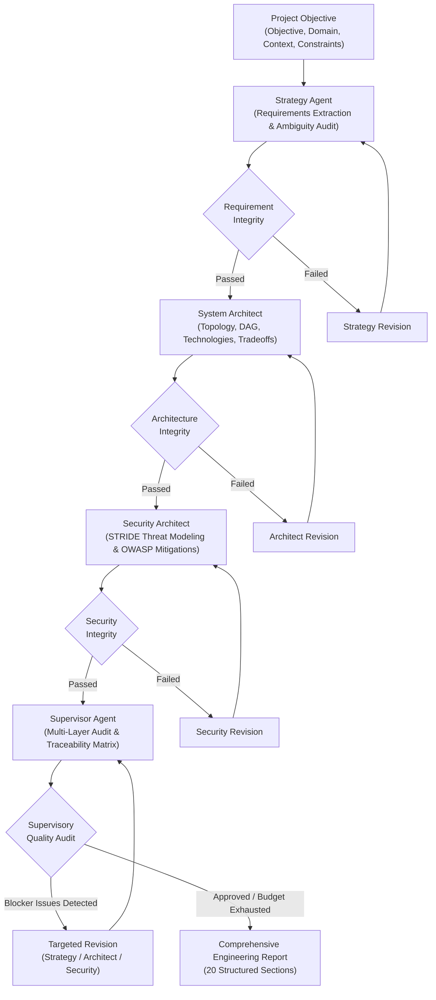

# 🔥 FORGE: Multi-Agent AI System for Automated System Design and Engineering Analysis

[](https://github.com/MackenzieCampbelAndross/FORGE)
[](https://www.python.org/)
[](LICENSE)
[]()
[](https://github.com/astral-sh/ruff)
[](http://mypy-lang.org/)

---

## 1. Project Description & Problem Statement

Modern software system design requires rigorous requirement engineering, component boundary decomposition, technology tradeoff assessment, and threat modeling. When performed manually, architecture reviews can be slow, inconsistent, and error-prone. Conversely, naive single-prompt LLMs produce vague, unvalidated prose with broken dependencies, hallucinated components, and missing security mitigations.

**FORGE** is a multi-agent engineering intelligence platform that transforms high-level software objectives into structured, technically defensible, and validated system blueprints. Through specialized Strategy, System Architecture, Security, and Supervisory agents orchestrated via LangGraph, FORGE enforces deterministic integrity checks, requirement traceability matrices, STRIDE threat models, and bounded revision loops.

> **Important:** FORGE is an engineering design, analysis, and validation platform. It is NOT an autonomous coding or deployment agent; its primary deliverable is a validated engineering blueprint.

---

## 2. Core Philosophy

1. **Engineering correctness** over impressive language.
2. **Structured outputs** over unrestricted text.
3. **Traceability** over unsupported recommendations.
4. **Evidence** over fabricated confidence.
5. **Reproducibility** over unverifiable claims.
6. **Measurable performance** over subjective demonstrations.

---

## 3. Architecture & Orchestration

FORGE implements a cyclic, stateful multi-agent architecture powered by **LangGraph**:



---

## 4. The Four Specialized Agents

| Agent | Role | Primary Responsibility |
|---|---|---|
| **Strategy Agent** | Chief Strategy Officer | Elicits functional and non-functional requirements, classifies mandatory constraints, extracts acceptance criteria, detects logical contradictions, and flags vague claims. |
| **System Architect** | Principal System Architect | Decomposes requirements into component topologies, defines communication interfaces, enforces dependency DAG validity, designs data flows, and structures technology decisions. |
| **Security Architect** | Chief Information Security Officer | Executes STRIDE threat modeling across attack surfaces, calculates deterministic risk scores (0–10 scale), and specifies OWASP-aligned mitigations and residual risks. |
| **Supervisor Agent** | Quality Control & Audit Director | Performs multi-layer static and semantic audits, computes bidirectional requirement traceability matrices, triggers bounded revision loops, and compiles the final 20-section report. |

---

## 5. Technology Stack

- **Core Runtime:** Python 3.11+ / 3.12
- **Agent Orchestration:** LangGraph, LangChain Core
- **Data Validation:** Pydantic v2
- **API Framework:** FastAPI, Uvicorn
- **AI Integration:** Google Gemini API (`google-genai`), deterministic `MockModelProvider`
- **Database & Storage:** PostgreSQL, SQLite, SQLAlchemy 2.0, Alembic
- **Testing & Quality:** Pytest, Ruff, MyPy
- **Evaluation & Benchmarks:** Pandas, NumPy, MLflow
- **Containerization:** Docker, Docker Compose

---

## 6. Installation & Quickstart

### 6.1 Prerequisites
- Python 3.11 or 3.12
- Git

### 6.2 Setup Virtual Environment
```bash
# Clone the repository
git clone https://github.com/MackenzieCampbelAndross/FORGE.git
cd FORGE

# Create virtual environment
python -m venv venv

# Activate virtual environment
# Windows:
.\venv\Scripts\activate
# Linux/macOS:
source venv/bin/activate

# Install dependencies in editable mode
pip install -e ".[dev]"
```

### 6.3 Configuration
```bash
cp .env.example .env
# By default, FORGE_MODEL_PROVIDER=mock allows 100% offline, deterministic execution.
# For live Gemini calls, set FORGE_MODEL_PROVIDER=gemini and provide GOOGLE_API_KEY.
```

### 6.4 Initialize Database
```bash
alembic upgrade head
```

---

## 7. Command Line Interface (CLI)

### Run Analysis on an Objective
```bash
python scripts/run_forge.py --objective "Design a real-time event streaming pipeline with Kafka and PostgreSQL"
```

### Run Analysis from an Input JSON
```bash
python scripts/run_forge.py --input examples/healthcare.json --output-dir outputs
```

### Validate Benchmark Dataset (FEB v1.0)
```bash
python scripts/validate_dataset.py
```

### Execute Benchmark Suite
```bash
python scripts/run_benchmark.py --limit 10 --export-json outputs/benchmark.json --export-csv outputs/benchmark.csv
```

### Execute Baseline Comparative Experiments
```bash
python scripts/run_baselines.py --limit 3
```

### Execute Systematic Ablation Studies
```bash
python scripts/run_ablation.py --scenario-id FEB-BACKEND-001
```

---

## 8. REST API

Start the FastAPI application:
```bash
uvicorn forge.api.main:app --host 0.0.0.0 --port 8000 --reload
```

Interactive Documentation:
- Swagger UI: [http://localhost:8000/docs](http://localhost:8000/docs)
- ReDoc: [http://localhost:8000/redoc](http://localhost:8000/redoc)

### Primary Endpoints
- `GET /health` — System status and active provider
- `POST /api/v1/projects` — Create project record
- `POST /api/v1/analyze` — Trigger engineering analysis
- `GET /api/v1/analysis/{analysis_id}` — Check status and metrics
- `GET /api/v1/analysis/{analysis_id}/report` — Retrieve report in JSON or Markdown format
- `POST /api/v1/evaluation/run` — Run benchmark evaluation suite
- `GET /api/v1/benchmark/summary` — View FEB dataset statistics

---

## 9. FORGE Engineering Benchmark (FEB) v1.0

The FORGE Engineering Benchmark (FEB) v1.0 consists of **100 standardized scenarios** across 7 categories:
1. **Backend Systems:** 20 scenarios
2. **Distributed Systems:** 15 scenarios
3. **AI and ML Systems:** 15 scenarios
4. **Database Systems:** 15 scenarios
5. **Cloud Infrastructure:** 15 scenarios
6. **Security Critical Systems:** 10 scenarios
7. **General Software Architecture:** 10 scenarios

Total: **100 Scenarios**.

---

## 10. Automated Testing & Verification

All automated tests execute without external API keys:
```bash
# Run test suite
pytest -v

# Run code style & linting
ruff check .
ruff format --check .

# Run strict type checking
python -m mypy forge
```

---

## 11. Architecture Export Formats & Model Providers

### Supported Diagram and Document Exporters
Every blueprint synthesized by FORGE can be serialized using `ReportExporter`:
- **Interactive HTML**: Self-contained web dashboard with client-rendered Mermaid.js diagrams.
- **Graphviz DOT**: Orthogonal directed graphs (`.dot`) for CI/CD visualization pipelines.
- **Structurizr C4 DSL**: Enterprise architecture models (`.dsl`) with Container and System Context views.
- **PlantUML**: Standard component diagrams (`.puml`) with environment packaging.
- **Terminal ASCII**: Monospaced terminal diagram rendering for CLI and log outputs.
- [Detailed Guide](docs/EXPORT_FORMATS.md)

### Supported Model Providers & Resilience
- **Google Gemini**: Modern Google GenAI SDK integration.
- **Local Ollama**: 100% offline, air-gapped execution (Llama 3, Mistral, DeepSeek-R1, Qwen 2.5).
- **OpenAI & Compatible**: GPT-4o, vLLM, Groq, Together, Azure OpenAI endpoints.
- **Anthropic Claude**: Claude 3.5 Sonnet / Opus via Messages API.
- **Resilience Engine**: Token-bucket rate limiting, 4-mode jitter exponential backoff, and transparent multi-provider failover (`FallbackModelProvider`).
- [Detailed Guide](docs/MODEL_PROVIDERS.md)

---

## 12. Enterprise Blueprint Examples

Explore production-grade system specifications in the `examples/` directory:
- [Autonomous Vehicle Telemetry Ingestion](examples/autonomous_vehicle.json) — 1M vehicles, 10M msg/sec, ISO 26262 ASIL D safety telemetry.
- [Crypto Order Matching Engine](examples/crypto_exchange.json) — Sub-100µs deterministic LMAX ring buffer, Aeron Raft state machine.
- [Global Video Streaming CDN](examples/video_cdn.json) — 50M concurrent streams, Anycast edge cache, GPU transcoding.
- [Multi-Tenant SaaS RBAC Platform](examples/saas_rbac.json) — Zanzibar ReBAC, PostgreSQL Row-Level Security, CMEK envelope encryption.

---

## 13. Documentation Index

- [ARCHITECTURE.md](docs/ARCHITECTURE.md) — Comprehensive architectural relationships and diagrams.
- [TECHNICAL_SPECIFICATION.md](docs/TECHNICAL_SPECIFICATION.md) — Schemas, data models, and algorithms.
- [AGENT_DESIGN.md](docs/AGENT_DESIGN.md) — Agent responsibilities and revision loops.
- [DEVELOPER_GUIDE.md](docs/DEVELOPER_GUIDE.md) — Step-by-step custom agent authoring guide.
- [SYSTEM_DESIGN_CHEATSHEET.md](docs/SYSTEM_DESIGN_CHEATSHEET.md) — Production architecture interview reference.
- [SCENARIO_CATALOG.md](docs/SCENARIO_CATALOG.md) — Catalog of all 100 FEB benchmark scenarios.
- [EXPORT_FORMATS.md](docs/EXPORT_FORMATS.md) — Guide to Graphviz, C4 DSL, PlantUML, and HTML exports.
- [MODEL_PROVIDERS.md](docs/MODEL_PROVIDERS.md) — LLM provider setup, failover, and rate limiting.
- [BENCHMARK_METHODOLOGY.md](docs/BENCHMARK_METHODOLOGY.md) — FEB dataset construction and scoring.
- [METRICS.md](docs/METRICS.md) — Mathematical definitions for all 25+ metrics.
- [API_REFERENCE.md](docs/API_REFERENCE.md) — Complete REST endpoint documentation.
- [EXPERIMENTS.md](docs/EXPERIMENTS.md) — Baselines and ablation studies.
- [LIMITATIONS.md](docs/LIMITATIONS.md) — System boundaries and scope definitions.
- [REPRODUCIBILITY.md](docs/REPRODUCIBILITY.md) — Exact steps to reproduce all experiments.

---

## 14. Roadmap

- [x] v1.0.0 — Multi-Agent System Design Engine, FEB 100 Dataset, STRIDE Modeling, Traceability Matrix, FastAPI, SQLite/PostgreSQL persistence.
- [x] Multi-Provider Architecture (Gemini, Ollama, OpenAI, Anthropic, Mock).
- [x] Multi-Format Exporters (Markdown, JSON, HTML, Graphviz DOT, C4 DSL, PlantUML, ASCII).
- [x] Enterprise Blueprint Examples (Autonomous Vehicle, Crypto Exchange, Video CDN, SaaS RBAC).
- [ ] v1.1.0 — Interactive Human-in-the-Loop review pane via WebSockets.
- [ ] v1.2.0 — Multi-cloud cost estimator integration (AWS/GCP/Azure pricing APIs).
- [ ] v1.3.0 — Automated Infrastructure-as-Code (Terraform) blueprint scaffolding export.

---

## 15. License

Apache-2.0 License. Developed by Mackenzie Campbel Andross.
