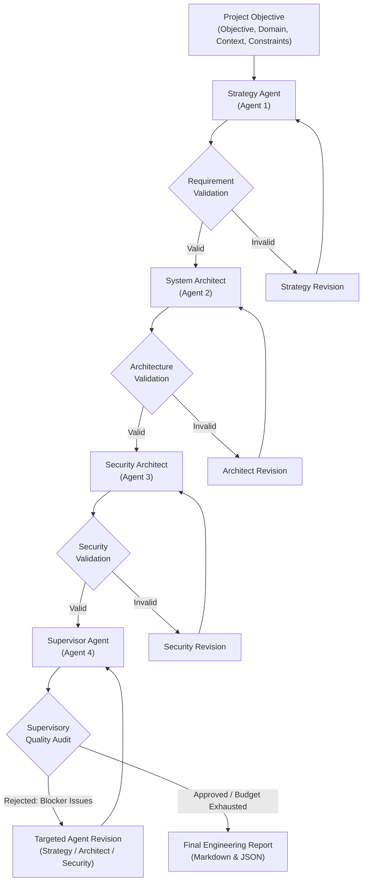

# FORGE v1.0 — Architecture and System Design

## 1. System Overview

FORGE is a multi-agent AI engineering platform that automates high-level software system design, requirement traceability, technology decision analysis, and STRIDE-based threat modeling.

It transforms informal or high-level engineering objectives into structured, technically defensible, and validated system blueprints.

---

## 2. Component Subsystems

### 2.1 Agent Core (`forge.agents`)
- **Strategy Agent:** Conducts requirement elicitation, identifies constraints, uncovers ambiguities, detects logical contradictions, and produces a structured requirements document.
- **System Architect:** Formulates component topology, defines interfaces, declares dependencies, structures data flows, and produces defensible technology choices.
- **Security Architect:** Performs STRIDE threat modeling on components and communication boundaries, determines deterministic risk scores, and maps mitigations to OWASP Top 10 standards.
- **Supervisor Agent:** Audits cross-agent artifacts, validates requirement coverage, computes traceability matrices, requests targeted revisions under bounded loops, and compiles the final report.

### 2.2 Intelligence Engines (`forge.intelligence`)
- **Requirement Analyzer:** Performs regex-based semantic contradiction detection and flags vague, non-numeric quality targets.
- **Constraint Analyzer:** Evaluates whether architectural choices satisfy specified system constraints.
- **Technology Evaluator:** Implements a transparent 9-factor multi-criteria weighted scoring framework with documented rationale.
- **Architecture Validator:** Deterministically validates component dependency DAGs, cycles, dangling interfaces, and invalid data flow endpoints.
- **Traceability Engine:** Computes bidirectional mappings and coverage percentages between requirements, components, interfaces, and threats.

### 2.3 Security Engine (`forge.security`)
- **STRIDE Threat Modeler:** Evaluates Spoofing, Tampering, Repudiation, Information Disclosure, Denial of Service, and Elevation of Privilege across component boundaries.
- **Risk Scoring Engine:** Implements a deterministic $3 \times 3$ Likelihood vs Impact scoring matrix ($0.0 - 10.0$) and calculates residual risk after mitigation.
- **Mitigation Catalog:** Standardizes mitigation controls aligned with OWASP Top 10 2021 and OWASP API Top 10 2023.

### 2.4 Orchestration Engine (`forge.orchestration`)
- **StateGraph:** Built with LangGraph, utilizing typed shared state (`ForgeState`), conditional supervisor routing edges, and bounded revision loops.

### 2.5 Storage and Persistence (`forge.storage`)
- **Relational Storage:** SQLAlchemy 2.0 ORM with PostgreSQL and SQLite support.
- **Alembic Migrations:** Full versioned schema migrations for audit logs, projects, and execution records.
- **Repository Pattern:** Isolated persistence abstraction for projects, executions, and reports.

### 2.6 REST API (`forge.api`)
- **FastAPI Layer:** High-performance asynchronous API endpoints for project lifecycle management, synchronous/background analysis, report retrieval, and benchmark runs.
